# VLC, redesigned

The interface of VLC 4, rebuilt after the redesign concept by
[Juxtopposed](https://www.youtube.com/@Juxtopposed): the library, the player,
the dialogs and the preferences, in Qt Quick, on top of the VLC 4 development
code.

> [!IMPORTANT]
> This is an **unofficial** build for testing the redesign. It is not made,
> endorsed or supported by [VideoLAN](https://www.videolan.org/). VLC 4 itself
> is still in development: expect bugs, and keep using the
> [official VLC](https://www.videolan.org/vlc/) for anything that matters.

https://github.com/user-attachments/assets/92091a77-38c8-4a07-92d6-3b03da4adadf

**[Download for Windows](../../releases)** · [The code](https://code.videolan.org/jonata/vlc/-/tree/player-redesign) ·
[The original redesign video](https://www.youtube.com/watch?v=ERFeOgqk324)

## What changed

### First run

A short welcome replaces the first-run wizard: choose the folder of your
media, the theme and its accent color, and learn the main shortcuts.

<p>
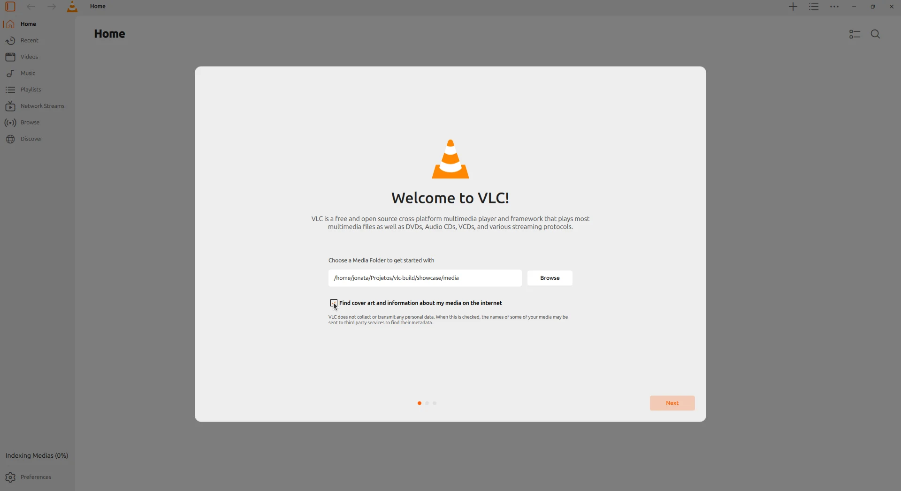
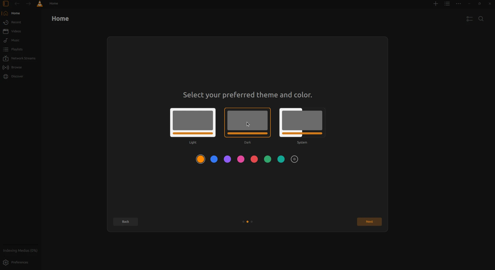
</p>

### Library

- A **Home** page with *Continue Watching*, your playlists, your network streams
  and the newest videos and music
- **Recent**, **Videos**, **Music** (songs, albums, artists, genres),
  **Playlists**, **Network Streams**, **Browse** and **Discover** in the sidebar
- Playlists, folders and browsed folders can be **pinned** to the sidebar
- Back and forward navigation, an address bar, and a **+** menu to add folders,
  playlists, files and streams
- Sorting by watched and unwatched videos

<p>
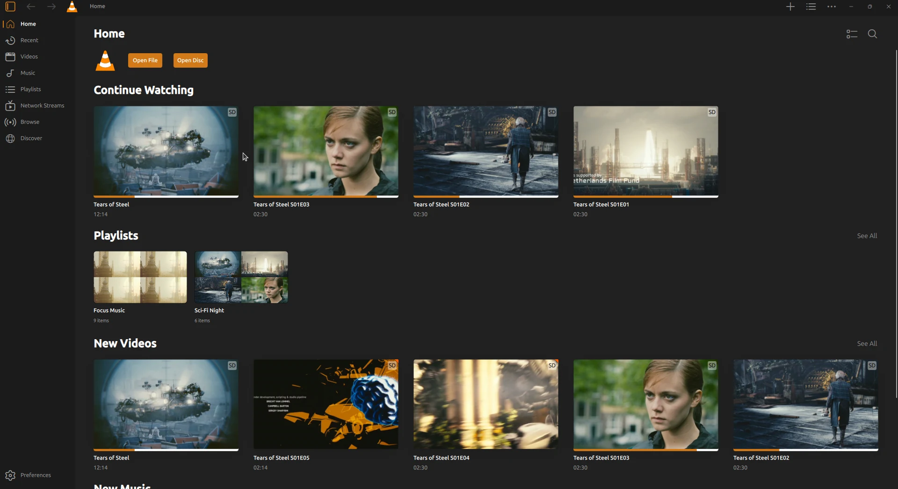
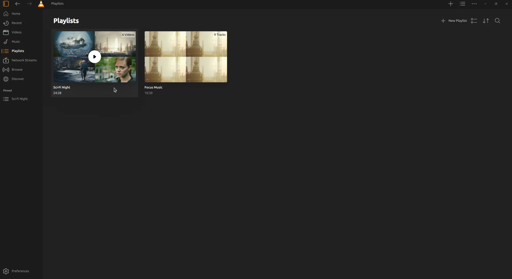
</p>
<p>
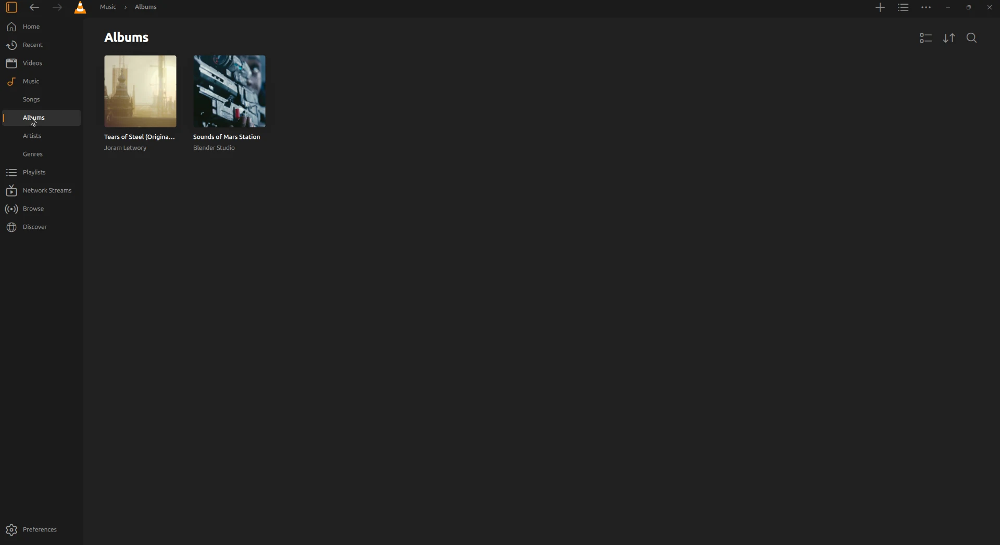
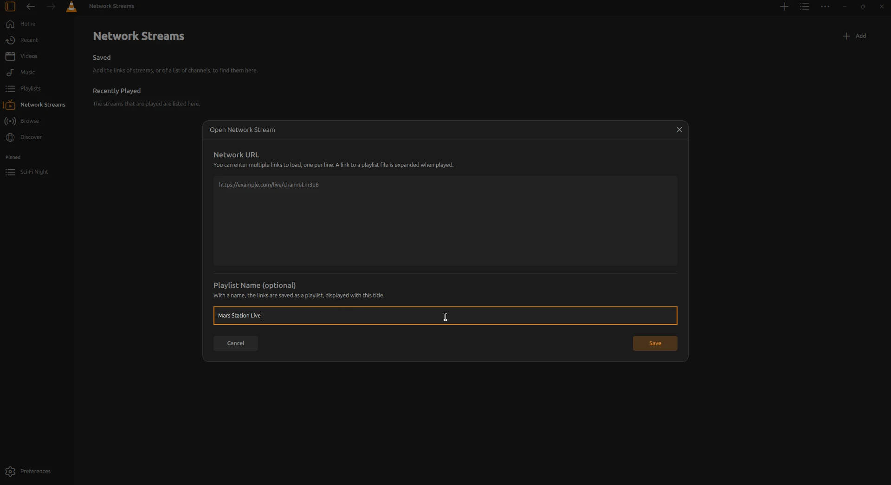
</p>

### Player

- **Seek previews**: a thumbnail of the video while scrubbing
- A **player settings** panel for subtitles, audio, video and playback: tracks,
  delays, subtitle style, picture adjustments, equalizer, speed, A-B loop,
  sleep timer and visualizations, with presets saved per folder
- A **subtitle timeline** on the seek bar, to see and shift the subtitles
- Playback **statistics** over the video
- **Bookmarks** (Ctrl+B) and chapters next to the play queue
- **Continue where you left off**, asked when playback starts
- **Add Subtitles**: finds the subtitle files that match your videos
- A restyled right-click menu, with icons and shortcuts
- The shortcut used is shown on the video

<p>
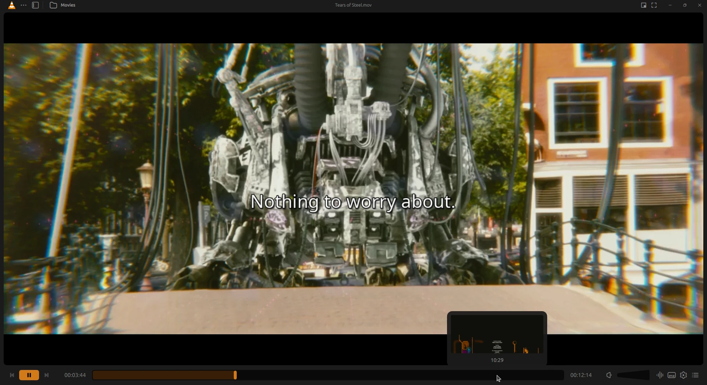
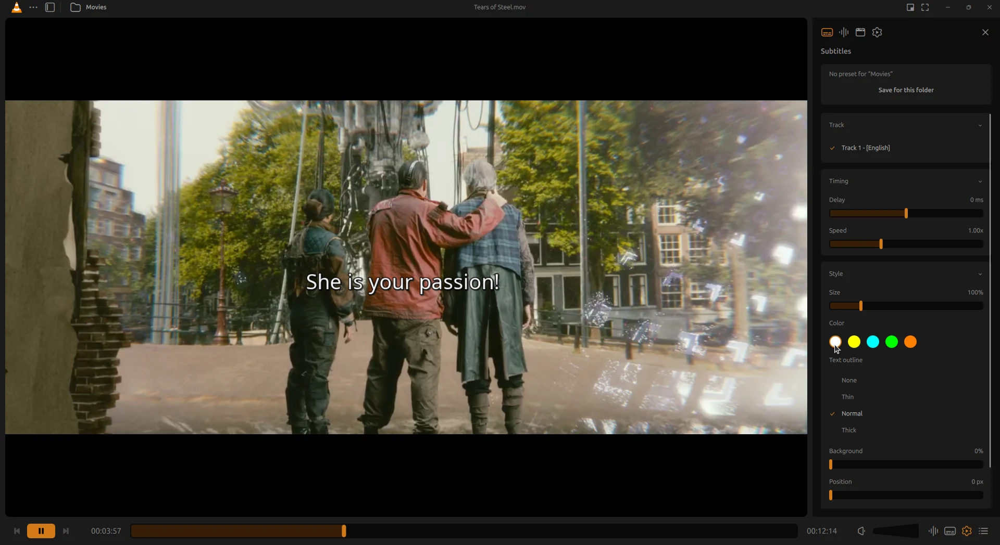
</p>
<p>
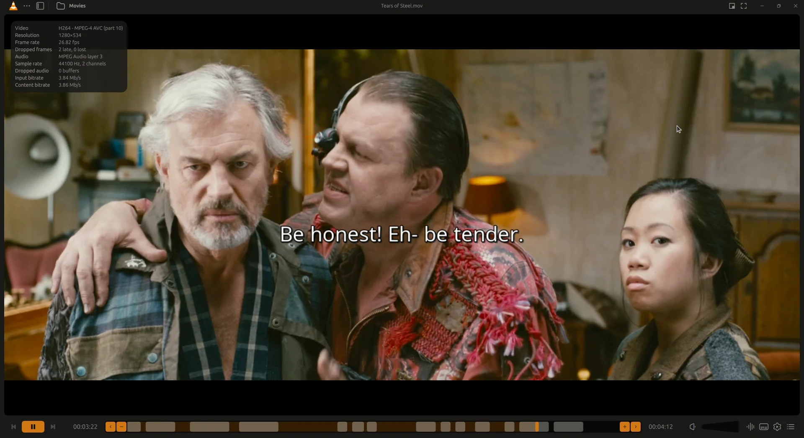
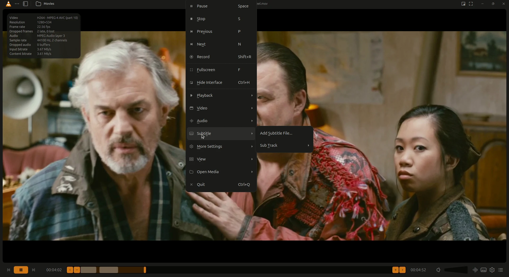
</p>
<p>
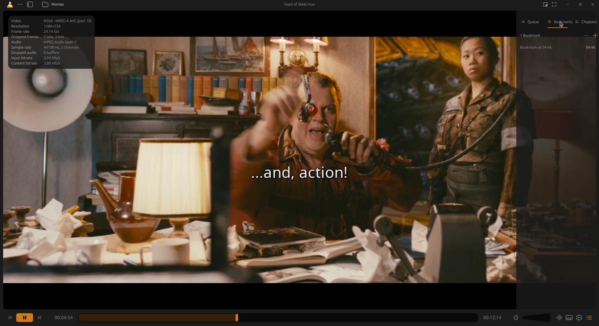
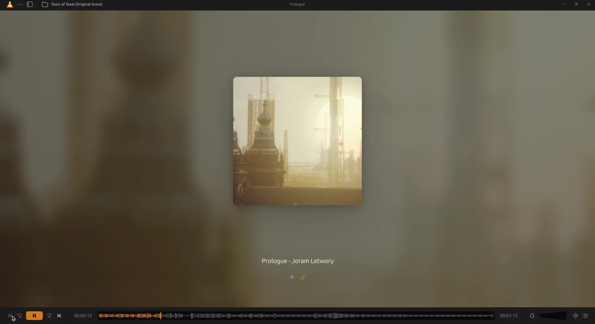
</p>

### Customize the player

Drag controls from the palette into the control bar, or out of it.

<p>
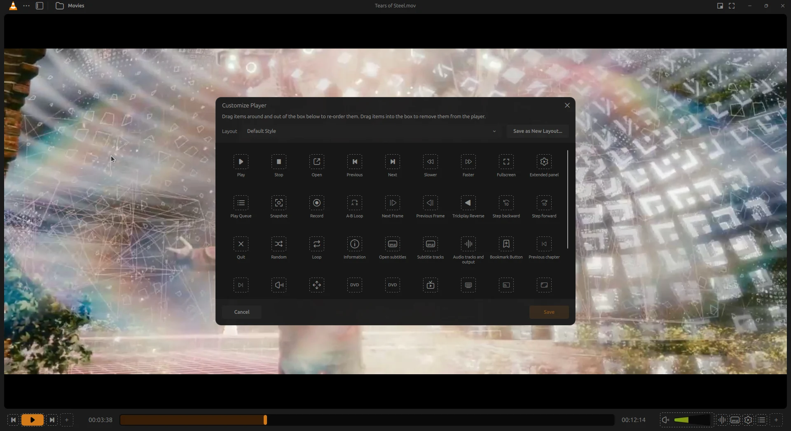
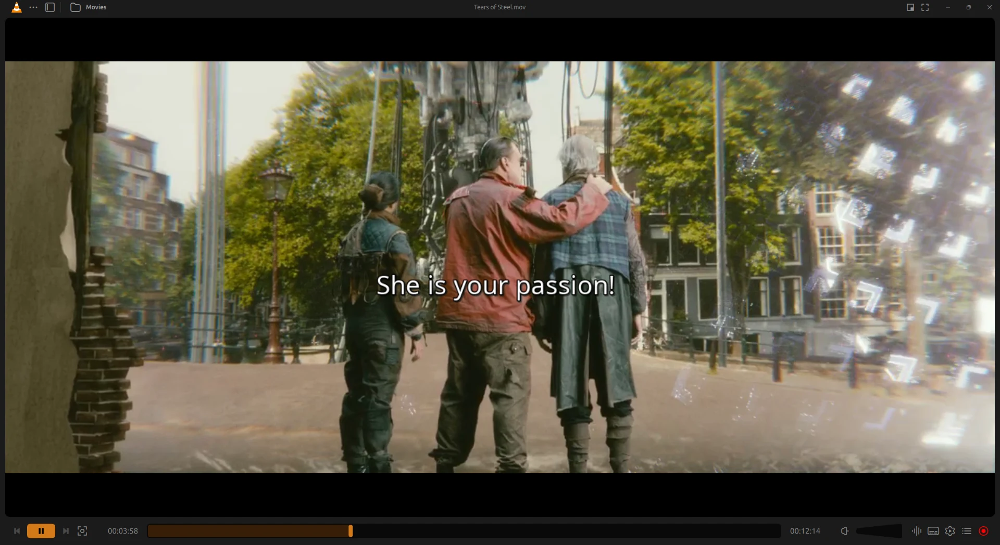
</p>

### Dialogs and preferences

- **Keyboard Shortcuts**: search the shortcuts, and change one by pressing
  the new key
- New dialogs to **open network streams**, **capture** devices, **convert**
  files and **stream** to devices
- **Preferences** grouped by subject, with a search over every option, the
  less common ones folded, and the complete preferences still one click away

<p>
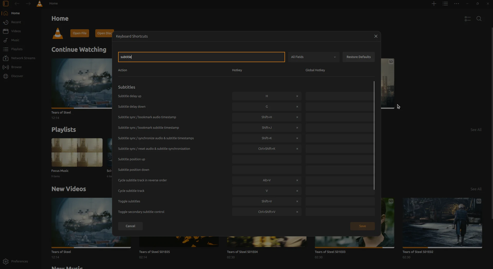
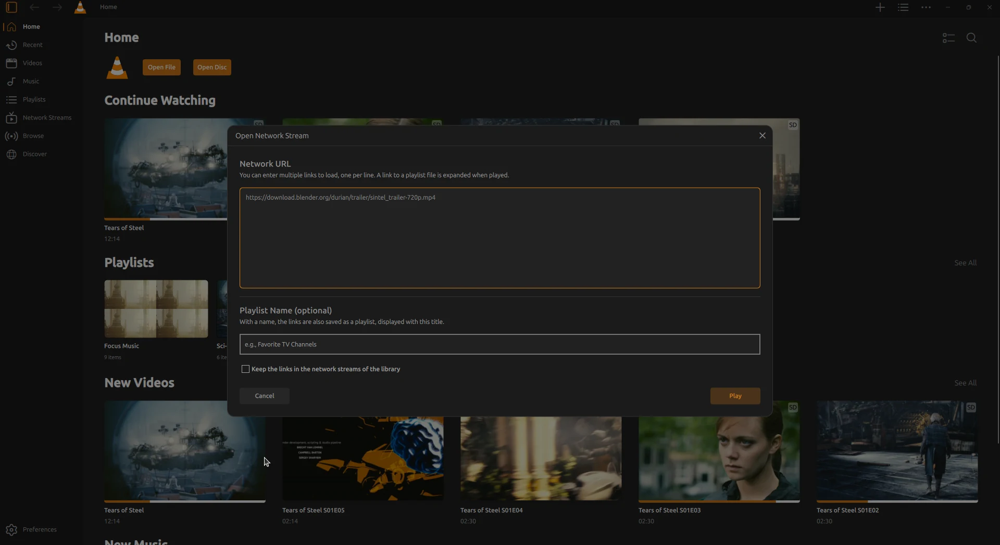
</p>
<p>
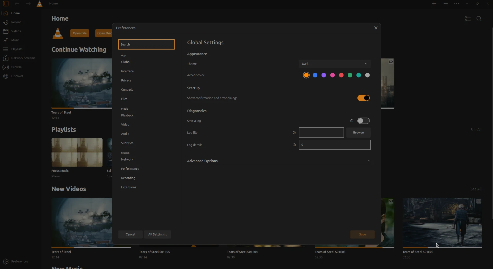
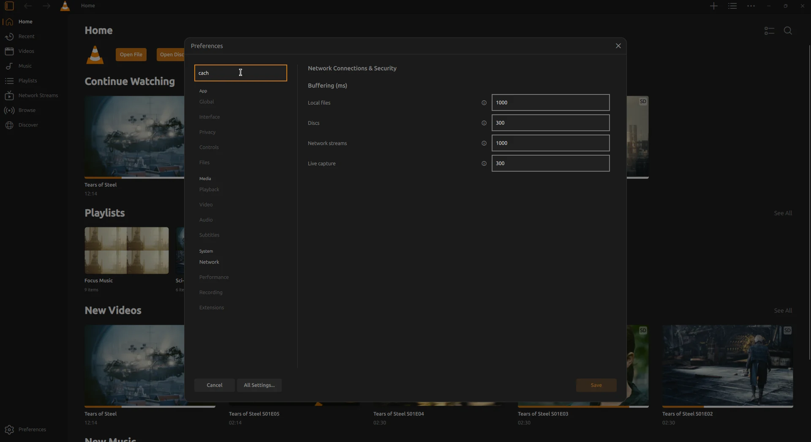
</p>

## Download

Builds for Windows (64-bit) are on the [releases page](../../releases). They are
not signed: Windows may warn about them before running them.

The builds are made by [GitHub Actions](.github/workflows/windows.yml) from the
[`player-redesign`](../../tree/player-redesign) branch, with the tools and the
prebuilt libraries of VideoLAN.

## Build it yourself

The code is on the `player-redesign` branch, also at
[code.videolan.org/jonata/vlc](https://code.videolan.org/jonata/vlc/-/tree/player-redesign).
It builds like VLC 4: see [Compile VLC](https://wiki.videolan.org/Category:Building/)
on the VideoLAN wiki.

```bash
git clone --branch player-redesign https://github.com/jonata/vlc.git
cd vlc
meson setup build
meson compile -C build
```

## Status

The redesign is being proposed to VideoLAN in pieces. Not done yet, or known
to be incomplete:

- some options of the redesigned preferences have no setting in VLC yet
- the media information, effects and messages windows keep their old look
- only tested on Linux (X11 and Wayland) so far

Issues and feedback are welcome in the [issues](../../issues).

## Credits

- Redesign concept: [Juxtopposed](https://www.youtube.com/@Juxtopposed)
- VLC: [VideoLAN](https://www.videolan.org/) and the VLC contributors.
  VLC and the cone are trademarks of VideoLAN.
- Footage in the screenshots and the video:
  [Tears of Steel](https://mango.blender.org/) (CC BY 3.0) © Blender Foundation

## License

VLC media player is free software, released under the
[GNU General Public License, version 2 or later](https://github.com/jonata/vlc/blob/player-redesign/COPYING)
(libVLC under the [GNU Lesser General Public License](https://github.com/jonata/vlc/blob/player-redesign/COPYING.LIB)),
and so are these changes.
